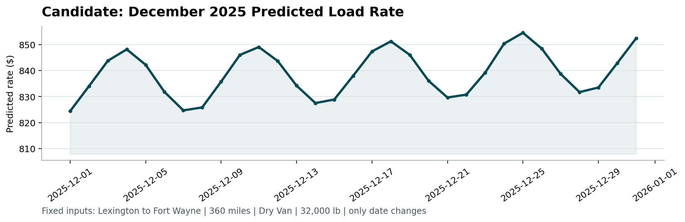
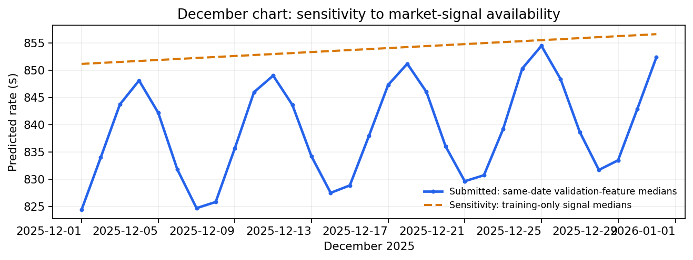

# Freight Rate Prediction Challenge

A reproducible freight-rate prediction pipeline for the Machine Learning Engineer assessment. Given a load's route, distance, equipment, weight, date and available market features, it predicts `posted_rate` with an interpretable log-linear model.

**Deliverables in this repository:** [12,000 validation predictions](outputs/validation_predictions.csv) · [31 December scenario predictions](outputs/december-chart-inputs.csv) · [DOCX report](reports/freight_rate_report.docx) · [official scorer chart](reports/candidate_december.png). A 2–3 minute Loom walkthrough must be linked separately before the final submission.

> **Evaluation boundary:** On the Jan–Aug → Sep–Oct out-of-time holdout, the *selected batch-inference policy* obtains **$48.13 clean-row MAE / 2.07% MAPE / 0.99716 R²**, and **$104.08 MAE / 0.82813 R² across all labeled holdout rows**. These are holdout results—not hidden validation scores. The supplied scorer checks submission validity and generates a chart; it does **not** reveal hidden-target accuracy.



## Problem and outputs

| Supplied file | Role |
|---|---|
| `train-test.csv` | 48,000 labeled loads, Jan–Oct 2025; includes `posted_rate`. |
| `validation.csv` | 12,000 unlabeled loads, Nov–Dec 2025; predict **every** row. |
| `validation-predictions-template.csv` | Required `load_id` ordering for the final two-column CSV. |
| `december-chart-inputs.csv` | 31 fixed December loads whose `predicted_rate` must be filled. |

The two finished CSVs are already present in [`outputs/`](outputs/). Raw assessment CSVs are intentionally **not committed**; obtain them from the assessment package and place them in `data/` as described in [`data/README.md`](data/README.md).

## Reproduce the submission

Run from the repository root with Python 3.10+:

```bash
python -m pip install -r requirements.txt

# First copy the four original assessment CSVs into data/ (names above).
python freight_rate_model.py \
  --train data/train-test.csv \
  --validation data/validation.csv \
  --template data/validation-predictions-template.csv \
  --december data/december-chart-inputs.csv \
  --out outputs/validation_predictions.csv

python score.py \
  --predictions outputs/validation_predictions.csv \
  --december-predictions outputs/december-chart-inputs.csv
```

The prediction command fits the model and writes **both** `outputs/validation_predictions.csv` and `outputs/december-chart-inputs.csv`. It does not overwrite the raw December input in `data/`. The scorer writes `scorer_results/candidate_december.png`; the identical official chart is included at [`reports/candidate_december.png`](reports/candidate_december.png). Expected scorer messages: `Validated 12,000 final predictions.` and `Validated 31 fixed December predictions.`

Verify the **packaged** CSVs, chart and DOCX before regenerating them: `sha256sum -c SHA256SUMS.txt` (run from the repository root).

To reproduce the diagnostics and report:

```bash
python validate.py                       # reference-imputation holdout, rolling table, plots
python validation_signal_sensitivity.py # selected vs reference policy on the holdout
python december_signal_sensitivity.py   # submitted December curve vs fallback
python -m pip install 'scikit-learn>=1.4,<2' # optional: only for the family audit
python model_family_audit.py data/train-test.csv
python make_report.py                    # rebuilds reports/freight_rate_report.docx
```

**Optional audit dependency:** `scikit-learn` is needed for `model_family_audit.py`, not for the production prediction pipeline. `requirements.txt` contains pandas, NumPy, Matplotlib and python-docx (the latter two support charts and report rebuilding).

## How the model works

1. **Audit labeled data.** Inspect target distribution, missing values, negative weights, distance/coordinate behavior, city coverage and date patterns. The dominant modeling issue is the target's separated multiplicative tails; the other issues are handled in preprocessing or documented.
2. **Prepare training features.** Use `log(distance)`, its square, `market_index`, `quote_signal`, `log(|weight|)`, equipment indicators, days since 2025-01-01, and pickup/delivery city effects. Training-partition missing values use medians calculated from that partition.
3. **Flag extreme training targets.** Fit a simple time-free log-rate reference model; estimate robust residual scale as `1.4826 × MAD`; retain rows within `6 × robust_scale` of the median residual. This leaves **47,323 of 48,000 labeled training rows** (677 flagged; 1.41%). **Filtering applies only to labeled training data:** all 12,000 validation and all 31 December rows receive predictions.
4. **Fit the final model.** Ordinary least squares on `log(posted_rate)` (`numpy.linalg.lstsq`), with 135 coefficients: intercept + 8 non-city terms + 63 pickup-city + 63 delivery-city indicators. Exponentiate the result to return a dollar rate. The `[25, 40,000]` clip is an output-validity guard and did not bind on the evaluated data.
5. **Handle cities not seen during training.** An unseen city receives the mean fitted city effect rather than the drop-first baseline's zero effect. Eight unseen validation cities affect 1,447/12,000 loads (12.1%). In leave-one-city-out testing, this fallback produced $66.7 clean MAE versus $78.2 for a zero-effect fallback; this test does not reveal hidden-set accuracy.

A compact expression of the fitted model is:

```text
log(predicted_rate) = intercept + β₁·log(distance) + β₂·log(distance)²
                    + β₃·market_index + β₄·quote_signal + β₅·log(|weight|)
                    + β₆·is_reefer + β₇·is_flatbed + β₈·day_index
                    + pickup_city_effect + delivery_city_effect
```

Distance and equipment effects are multiplicative on the original dollar scale. The linear time trend is a measured choice for this future-month task, **not** a claim that a straight-line trend is always optimal.

## Feature availability at prediction time — important assumption

The **selected submission policy** uses *supplied, unlabeled feature rows from the same date* to fill missing market signals. Existing non-null per-load signals are retained; if a date has no usable same-date value, the fitted training median is the fallback.

- In `validation.csv`, **249 of 12,000** `market_index` values are null. The submitted predictions use the median of `market_index` among the *other supplied validation feature rows on that date*.
- The 31 December scenario rows contain neither `market_index` nor `quote_signal`. Both signals are filled with that date's median from the supplied December validation **features**.
- No validation `posted_rate` or hidden target is available or used. This is **not target leakage**, but it **assumes the same-date feature batch is available at inference**. A strictly row-by-row real-time service without those other feature rows must instead use the training-median fallback; that would be a different prediction policy.

The earlier training-median validation CSV differed on precisely those 249 rows. The final packaged [`validation_predictions.csv`](outputs/validation_predictions.csv) matches the candidate's saved Colab file byte-for-byte by SHA-256: `b8085412cf18441c36257fa8fefb0f7785c88fd71ce056a9028a323cde3a0b0d`. Its 12,000 rows are in template order, with mean predicted rate **$2,394.03**. The December file contains 31 rows with mean **$839.05** (range $824.42–$854.51). The supplied scorer accepted both files.

## Evaluation and model selection

The task predicts future months, so the primary labeled test is chronological: **fit on Jan–Aug, evaluate on Sep–Oct**. A held-out target may be used to calculate an evaluation metric or clean-row *reporting* mask; it is **never used to fit model coefficients or produce the submitted validation predictions**.

| Same fitted model; Sep–Oct holdout | Rows | MAE | MAPE | R² |
|---|---:|---:|---:|---:|
| **Selected same-date feature policy — clean** | 9,379 | **$48.13** | **2.07%** | **0.99716** |
| **Selected same-date feature policy — all rows** | 9,523 | **$104.08** | **4.58%** | **0.82813** |
| Training-median reference — clean | 9,379 | $48.30 | 2.08% | 0.99714 |
| Training-median reference — all rows | 9,523 | $104.27 | 4.58% | 0.82809 |

The same-date/reference comparison and RMSE values are in [`reports/validation_signal_sensitivity.csv`](reports/validation_signal_sensitivity.csv). `validate.py` generates the **reference-imputation** holdout/rolling artifacts; do not mistake those reference numbers for the selected-policy metrics above.

A separate **reference-policy, fixed-clean-mask model-family audit** compared unfiltered candidate fits on the Sep–Oct window:

| Compared family | Clean MAE | All-row MAE |
|---|---:|---:|
| Linear log-model, no time | $103.45 | $158.61 |
| **Linear log-model + time** | **$49.80** | **$105.71** |
| GBM, no time | $94.01 | $149.26 |
| GBM + time | $95.56 | $150.64 |

These are **not** the cleaned final pipeline's $48.13/$104.08 figures. Among the evaluated models under this out-of-time protocol, the linear log-model with a time trend performed best; this does not establish that linear models are inherently superior to GBM. See the [complete family audit](reports/model_family_audit.csv) and the [report](reports/freight_rate_report.docx) for baselines and protocol details.

Rolling two-month checks exposed a real caveat: the linear time treatment won 6 of 7 reference-policy windows against no time, but **Jul–Aug was an exception** (linear clean MAE $106.7 versus anchor-only $47.3). Over all seven windows, linear's mean clean MAE was $100.9; over the last four, anchor-only's $65.0 was lower than linear's $67.2. Giving recent windows more decision weight is a **deployment assumption**, not a mathematical fact.

## Data-quality findings and limits

| Observation | Treatment / limitation |
|---|---|
| 677 separated multiplicative target tails (1.41%) | Training-only robust filtering. The symmetric structure **strongly suggests** challenge-introduced synthetic target corruption; its provenance is an inference, not a known fact. All-row holdout metrics remain reported. |
| 292 negative training weights | `abs(weight)`, consistent with sign-flip corruption; the cause is not confirmed. |
| Missing training weight/market values | Medians computed from the fitting partition. Inference-time missing market signals follow the explicitly disclosed batch policy above. |
| Jittered lane distances; displaced supplied coordinates | Use the provided `distance`; coordinates are **not model inputs**. The coordinate displacement is measurable, but its cause is unknown. |
| Recurring routes | **Zero exact duplicate rows.** 47,933 rows share pickup–delivery lanes; this is not evidence that duplicate rows caused leakage. Chronological evaluation is chosen because the task forecasts later months. |

## December scenario and chart

The December file holds the same Lexington → Fort Wayne, 360-mile, Dry Van, 32,000-lb load with only the date changing. Same-date validation-feature signals give the submitted curve (mean **$839.05**, peak **Dec 25**). Replacing only those absent signals with training-only medians gives a flatter sensitivity curve (mean **$853.91**, peak **Dec 31**). The latter was **not submitted**. See the [daily sensitivity CSV](reports/december_signal_sensitivity.csv) and chart below.



## Repository map

| Path | Purpose |
|---|---|
| [`freight_rate_model.py`](freight_rate_model.py) | Production feature matrix, train-only robust cleaning, fit, batch inference and both output CSVs. |
| [`validate.py`](validate.py) | Reference-imputation chronological and rolling metrics plus diagnostic charts. |
| [`validation_signal_sensitivity.py`](validation_signal_sensitivity.py) | Same-date versus training-median policy on the labeled time holdout. |
| [`model_family_audit.py`](model_family_audit.py) | Optional reference-policy OLS/GBM family comparison. |
| [`december_signal_sensitivity.py`](december_signal_sensitivity.py) | Submitted December feature assumption versus training-median fallback. |
| [`score.py`](score.py) | Assessment-supplied submission checker and official chart generator. |
| [`make_report.py`](make_report.py) | Rebuilds the DOCX report and embeds the official chart. |
| [`outputs/`](outputs/) | The **two completed submission CSVs**. |
| [`reports/`](reports/) | DOCX, official chart, model-selection tables and diagnostics. |
| [`data/README.md`](data/README.md) | Where to place the original, uncommitted assessment CSVs. |
| [`notebooks/visualize_everything.ipynb`](notebooks/visualize_everything.ipynb) | Optional single-cell Colab dashboards (audit, validation, predictions and rolling windows); upload the raw kit CSVs to `/content` before running. |

## Submission checklist

- [x] Train and evaluate with a chronological split; report both clean and all-row outcomes.
- [x] Predict all 12,000 validation rows in template order.
- [x] Fill all 31 December scenario rows; run the supplied scorer and include its chart.
- [x] Include a [DOCX report](reports/freight_rate_report.docx), reproducible code and dependencies.
- [ ] Add an **accessible GitHub repository URL** to the submission (verify it without a login).
- [ ] Record a **2–3 minute Loom**, add its shareable link here and submit it with the report/CSVs.

**Loom walkthrough:** _Add a public/shareable Loom URL here after recording._

For a detailed verification log, see [`FINALIZATION_CHECKLIST.md`](FINALIZATION_CHECKLIST.md). Scorer success is not evidence of performance on hidden targets; that result can only come from the evaluator.
